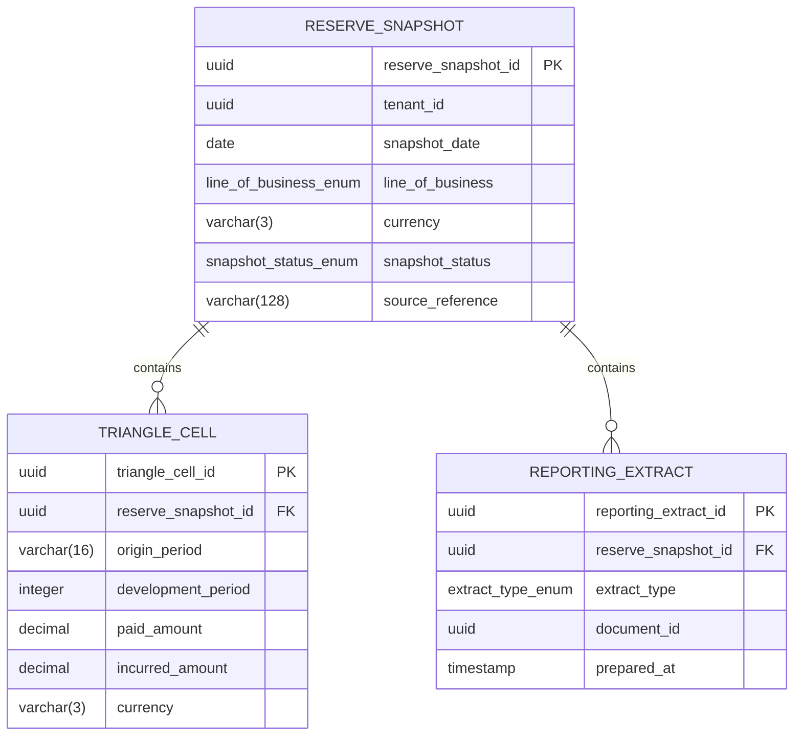

<a href="https://fireflysoftware.io/openplatform/">
<picture>
  <source media="(max-width: 640px) and (prefers-color-scheme: dark)" srcset="https://raw.githubusercontent.com/firefly-oss/.github/main/profile/assets/banner-narrow-dark.svg">
  <source media="(max-width: 640px)" srcset="https://raw.githubusercontent.com/firefly-oss/.github/main/profile/assets/banner-narrow-light.svg">
  <source media="(prefers-color-scheme: dark)" srcset="https://raw.githubusercontent.com/firefly-oss/.github/main/profile/assets/banner-dark.svg">
  
</picture>
</a>

# Firefly OpenPlatform - Core Insurance - Reserving

Developed by the Firefly Software Foundation. [dev@fireflysoftware.io](mailto:dev@fireflysoftware.io)

[Website](https://fireflysoftware.io/) · [OpenPlatform](https://fireflysoftware.io/openplatform/) · [Module catalogue](https://fireflysoftware.io/openplatform/modules/)

Core repository for reserving snapshots, loss-development triangle cells, and reporting extracts.

Repository: [https://github.com/firefly-oss/core-insurance-reserving](https://github.com/firefly-oss/core-insurance-reserving)

Stores figures the insurer's actuarial process has already produced. It does not calculate reserves and it does not certify a regulatory return. Case reserves on an individual claim stay in core-insurance-claims.

This is a **core** service. It owns its tables and exposes a reactive CRUD API. It does not call other core services. Domain orchestration is intentionally not in this repository.

## What it does not own

- Case reserves on a claim. Those are core-insurance-claims.
- Actuarial calculation, model selection, and sign-off.
- Regulatory certification of an IFRS 17 or Solvency II return. An extract here is input data, not a filed return.
- The document that holds a prepared file. documentId points at core-common-document-mgmt.

Cross-service identifiers are UUID columns without a database foreign key. A missing party, contract, product, document, distributor, policy, claim, or payment order is not enforced here. The domain layer, when it exists, is responsible for that coordination.

## Module structure

| Module | Purpose |
|--------|---------|
| `core-insurance-reserving-interfaces` | DTOs and enums |
| `core-insurance-reserving-models` | R2DBC entities, repositories, Flyway migrations |
| `core-insurance-reserving-core` | Services and MapStruct mappers |
| `core-insurance-reserving-web` | Spring Boot application and REST controllers |
| `core-insurance-reserving-sdk` | Reactive Java client generated from the OpenAPI document |

## Data model



Fields that point at another Firefly service are logical references. Foreign keys exist only inside this database.

## API

| Method | Path | Purpose |
|--------|------|---------|
| POST | `/api/v1/snapshots/filter` | Filter reservesnapshots |
| POST | `/api/v1/snapshots` | Create a ReserveSnapshot |
| GET | `/api/v1/snapshots/{reserveSnapshotId}` | Get a ReserveSnapshot |
| PUT | `/api/v1/snapshots/{reserveSnapshotId}` | Update a ReserveSnapshot |
| DELETE | `/api/v1/snapshots/{reserveSnapshotId}` | Delete a ReserveSnapshot |
| POST | `/api/v1/snapshots/{reserveSnapshotId}/cells/filter` | Filter trianglecells |
| POST | `/api/v1/snapshots/{reserveSnapshotId}/cells` | Create a TriangleCell |
| GET | `/api/v1/snapshots/{reserveSnapshotId}/cells/{triangleCellId}` | Get a TriangleCell |
| PUT | `/api/v1/snapshots/{reserveSnapshotId}/cells/{triangleCellId}` | Update a TriangleCell |
| DELETE | `/api/v1/snapshots/{reserveSnapshotId}/cells/{triangleCellId}` | Delete a TriangleCell |
| POST | `/api/v1/snapshots/{reserveSnapshotId}/extracts/filter` | Filter reportingextracts |
| POST | `/api/v1/snapshots/{reserveSnapshotId}/extracts` | Create a ReportingExtract |
| GET | `/api/v1/snapshots/{reserveSnapshotId}/extracts/{reportingExtractId}` | Get a ReportingExtract |
| PUT | `/api/v1/snapshots/{reserveSnapshotId}/extracts/{reportingExtractId}` | Update a ReportingExtract |
| DELETE | `/api/v1/snapshots/{reserveSnapshotId}/extracts/{reportingExtractId}` | Delete a ReportingExtract |

Missing rows return HTTP 404 through `ResourceNotFoundException`. A child row whose parent id does not match the path also returns 404.

Swagger UI: `/swagger-ui.html`. OpenAPI: `/v3/api-docs`.

## Configuration

| Variable | Description |
|----------|-------------|
| `DB_HOST` | PostgreSQL host |
| `DB_PORT` | PostgreSQL port |
| `DB_NAME` | Database name |
| `DB_USERNAME` | Database user |
| `DB_PASSWORD` | Database password |
| `DB_SSL_MODE` | `disable`, `require`, or another PostgreSQL SSL mode |
| `SERVER_ADDRESS` | Bind address, default `localhost` |
| `SERVER_PORT` | HTTP port, default `8080` |

Create an empty database before the first start. Flyway applies `db/migration` on boot.

## Build and run

```bash
mvn clean verify
mvn -pl core-insurance-reserving-web spring-boot:run
```

Java 25 and Maven 3.9 or newer. The parent POM is `io.fireflysoftware:firefly-parent:26.10.1`.

## Stack

Java 25, Spring Boot WebFlux, virtual threads, Spring Data R2DBC, PostgreSQL, Flyway, MapStruct, SpringDoc, Micrometer Prometheus.

## Actuator

| Endpoint | Purpose |
|----------|---------|
| `/actuator/health` | Liveness and readiness |
| `/actuator/info` | Build information |
| `/actuator/prometheus` | Metrics |

## Publisher

| | |
|--|--|
| Developed by | Firefly Software Foundation |
| Development contact | dev@fireflysoftware.io |
| Platform | https://openplatform.fireflysoftware.io |
| Website | https://fireflysoftware.io |
